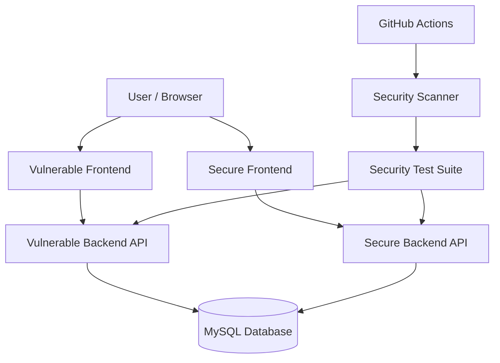

# SecureSaaS Application — Threat Model

## 1. Overview

This document identifies security threats affecting the SecureSaaS multi-tenant application and describes the controls intended to mitigate them.

The project contains two implementations:

- **Vulnerable application:** demonstrates selected application security weaknesses.
- **Secure application:** implements controls intended to mitigate those weaknesses.

The STRIDE framework is used to classify threats.

## 2. System Architecture

The application consists of:

- Vulnerable frontend and backend API
- Secure frontend and backend API
- MySQL database
- Automated security test suite
- Custom Node.js security scanner
- GitHub Actions CI workflows

Each frontend communicates with its corresponding backend. There is no API gateway or reverse proxy in the documented architecture.

Both backend implementations use MySQL.

## 3. Assets

| Asset | Description |
|---|---|
| User credentials | Account passwords and authentication information |
| JWTs | Tokens used to authenticate users |
| User information | Names, email addresses and account details |
| Tenant data | Organization-specific application data |
| Projects | Tenant-owned project records |
| Documents | Application documents belonging to tenants |
| User roles | Authorization and privilege information |
| Database | Persistent application data |
| Application secrets | JWT secrets and database credentials |
| Security logs | Records of security-relevant application activity |

## 4. Trust Boundaries

### TB-01: Browser to Backend

Browser-supplied information is untrusted. The backend is responsible for validating input, authenticating users and authorizing protected operations.

### TB-02: Backend to Database

Database operations are controlled by the backend. User input must not be directly interpolated into SQL queries.

### TB-03: Tenant Isolation

A user belonging to one organization must not access another organization's resources without explicit authorization. A client-supplied resource ID is not proof of ownership.

### TB-04: Authentication to Authorization

Authentication establishes a user's identity. Authorization determines what that user may do. A valid JWT does not automatically grant access to every resource or operation.

### TB-05: CI and Application Environment

CI credentials, JWT secrets and database credentials must be protected from unauthorized access and accidental disclosure.

## 5. STRIDE Threat Register

| ID | Category | Threat | Potential impact |
|---|---|---|---|
| T-01 | Spoofing | Forged, expired or invalid JWT accepted | Account impersonation |
| T-02 | Tampering | SQL injection through untrusted input | Unauthorized data access or modification |
| T-03 | Tampering | Client manipulates a role during user creation | Unauthorized privilege assignment |
| T-04 | Repudiation | Insufficient security-event logging | Difficult security investigation |
| T-05 | Information Disclosure | Cross-tenant access through manipulated resource IDs | Exposure of tenant data |
| T-06 | Information Disclosure | Detailed error responses reveal internal information | Information leakage |
| T-07 | Denial of Service | Excessive or oversized requests consume resources | Service degradation |
| T-08 | Elevation of Privilege | Normal user performs administrator-only actions | Unauthorized administrative operations |
| T-09 | Information Disclosure | Secrets or tokens exposed through logs or configuration | Credential compromise |
| T-10 | Spoofing | Weak password protection enables account compromise | Unauthorized account access |

## 6. Security Controls and Verification

| Threat | Intended control | Related verification |
|---|---|---|
| T-01 | JWT signature and claim validation | `authentication.test.js` |
| T-02 | Parameterized SQL and input validation | Injection and input-validation tests |
| T-03 | Server-controlled role assignment | `least-privilege.test.js` |
| T-04 | Structured security-event logging | Logging implementation review |
| T-05 | Tenant ownership checks on resource access | `bola.test.js` |
| T-06 | Controlled error responses | `error-handling.test.js` |
| T-07 | Request-size limits and rate controls | Configuration and test review |
| T-08 | Role-based and resource-level authorization | `least-privilege.test.js` |
| T-09 | Secret handling and sensitive-data redaction | Configuration and logging review |
| T-10 | Secure password hashing and validation | `password-security.test.js` |

A related test or control does not, by itself, prove that every aspect of a threat has been mitigated. Verification is limited to the behavior actually exercised or reviewed.

## 7. Security Testing Strategy

The vulnerable and secure implementations are compared using automated security regression tests. The project also uses a custom scanner, dependency auditing, CI workflows and OWASP ZAP.

The testing scope and execution instructions are documented in [`security-testing.md`](security-testing.md).

## 8. Assumptions and Limitations

- The application is a demonstration SaaS environment, not a production deployment.
- The backend is responsible for authorization decisions.
- Client-supplied resource identifiers and roles are untrusted.
- The threat model focuses primarily on application and API security.
- Production infrastructure hardening and advanced monitoring require separate assessment.
- Threats requiring further review must not be considered fully mitigated without implementation evidence and verification.

## 9. Future Review Areas

1. Review security-event coverage and audit-log storage.
2. Verify secret handling and sensitive-data redaction.
3. Review request-rate controls and denial-of-service protections.
4. Expand security regression coverage where justified.
5. Review dependency and supply-chain risks.
6. Reassess this threat model after significant architecture or functionality changes.